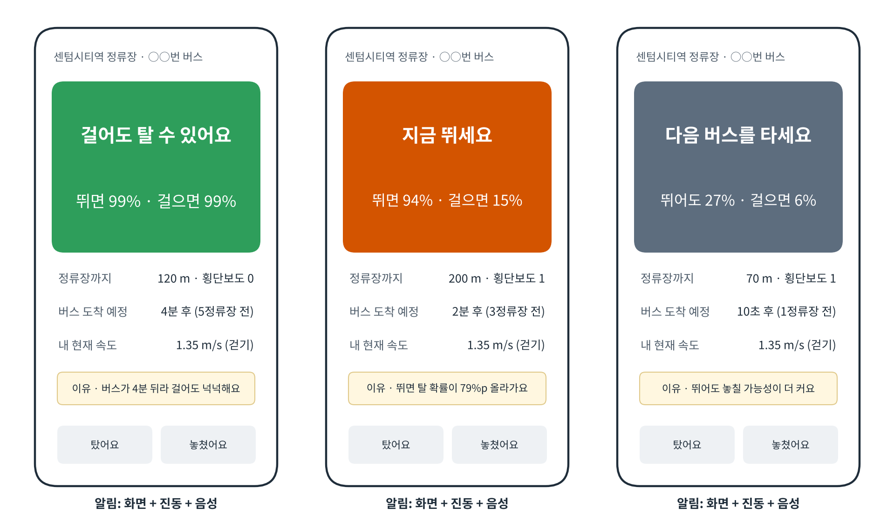
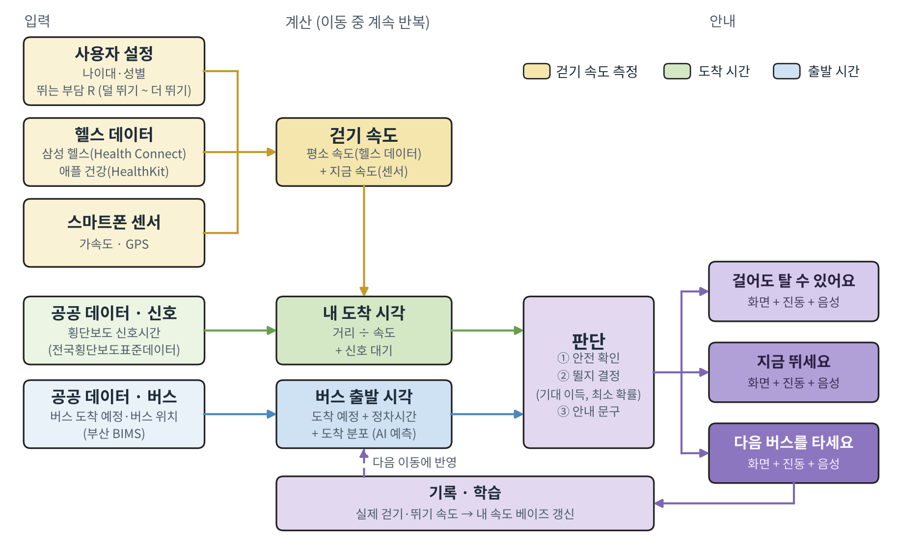

# 뛸까 말까? 🚌🏃

> 지금 뛰면 이번 버스를 탈 수 있을까?

버스 정류장으로 가는 보행자에게 **걸을 때와 뛸 때의 탑승 확률**을 계산해 알려 주는 안드로이드 앱입니다.
제64회 부산과학전람회(산업 및 에너지 부문) 출품을 위한 고등학생 연구 프로젝트로 개발하고 있습니다.

## 왜 만드나요

버스 도착 예정 시간에는 오차가 있어서, 이용자는 뛰었는데 놓치거나 걸어도 탈 수 있었는데 뛰는 일이 잦습니다.
'뛸까 말까?'는 부산버스정보시스템(BIMS)의 도착 정보에서 **도착 예정의 오차 분포**를 학습하고, 사용자의 **걷기 속도**와 **정류장까지의 거리**를 결합해 뛸지 말지를 판단합니다.

## 핵심 기술

| 기술 | 내용 |
|---|---|
| 확률 도착 예측 AI | BIMS 기록으로 도착 오차의 분위수 20개를 예측 (그래디언트 부스팅 분위수 회귀) |
| 개인화 학습 | 걸음 센서로 걷기·뛰기 속도를 추정하고 베이즈 갱신으로 개인에 맞춤 |
| 판단 엔진 | 탑승 확률, 배차간격, 뛰는 부담, 안전 조건(횡단보도·녹색 점멸·계단)으로 안내 결정 |

안내는 세 가지입니다: **"지금 뛰세요"**, **"걸어도 탈 수 있어요"**, **"다음 버스를 타세요"**

## 화면 설계안



## 서비스 흐름



## 활용하는 공공데이터

부산광역시_부산버스정보시스템 오픈API (공공데이터포털)

| 기능 | 쓰는 곳 |
|---|---|
| `stopArrByBstopid` 정류소 도착정보 | 도착 예정과 남은 정류장 수 → 도착 예정의 오차 계산 |
| `busInfoByRouteId` 노선별 버스 위치 | 버스가 정류장을 실제로 출발한 시각 판정 |
| `busStopList` 정류소 정보 | 정류소 번호와 위치 확인 |

### 수집 계획

- 대상: 부산진구·해운대구 정류장 6곳 (양방향 포함 정류소 8개)과 이 정류장을 지나는 노선
- 기간: 2026년 11월 ~ 2027년 3월, 매일 06~23시
- 간격: 15초 (실제 출발 시각을 정확히 판정하기 위해)
- 자료 구분: 11~1월 학습 / 2월 판단 기준값 결정 / 3월 평가

## 저장소 구성

```
collector/   BIMS 수집기 (갤럭시 S21 + Termux에서 실행)
docs/        설계 문서와 그림
```

## 일정

| 시기 | 내용 |
|---|---|
| 2026. 11. | BIMS 수집 시작, 계획서 제출 |
| 2026. 12. ~ 2027. 1. | 센서 실험(실험 1), 예측 모델·시뮬레이터 개발 |
| 2027. 2. ~ 3. | 예측 AI 학습, 앱 개발, 실사용 평가 시작 |
| 2027. 4. ~ 5. | 평가 분석, 작품설명서 제출 |

## 팀

러너워크 (Run or Walk)
